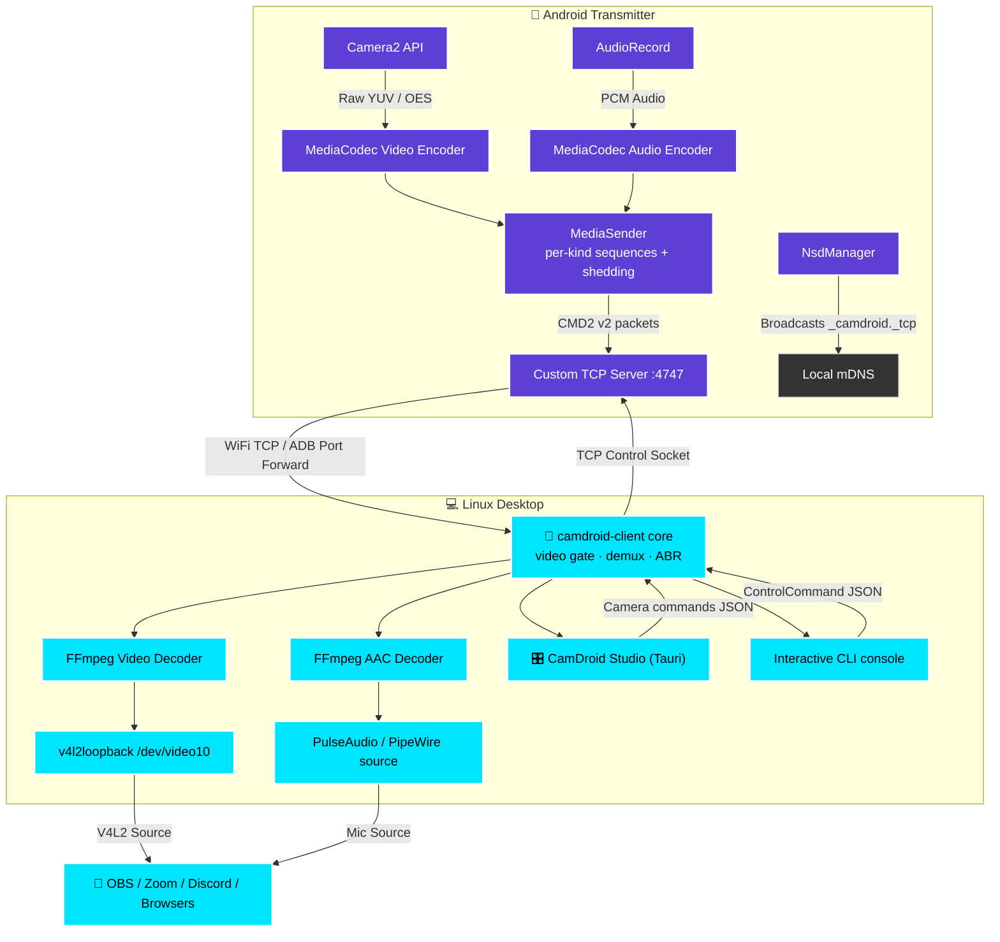

<p align="center">
  
</p>

# <p align="center">🎥 CamDroid</p>

<p align="center">
  <strong>Turn your Android phone into a high-performance, ultra-low-latency virtual webcam & microphone for Linux.</strong>
</p>

<p align="center">
  <a href="https://www.rust-lang.org/"></a>
  <a href="https://kotlinlang.org/"></a>
  <a href="https://tauri.app/"></a>
  <a href="https://github.com/v4l2loopback/v4l2loopback"></a>
</p>

<p align="center">
  🎛️ <b>CamDroid Studio GUI</b> • 🎮 <b>Interactive CLI</b> • 📺 <b>Up to 4K @ 60 FPS</b> • 🎙️ <b>AAC Audio</b> • 🔌 <b>WiFi & USB</b> • 💡 <b>Ring Light</b>
</p>

---

## 🌟 Why CamDroid?

**CamDroid** is a free, open-source replacement for apps like DroidCam and Iriun. The phone streams hardware-encoded H.264/H.265 video and AAC audio over a purpose-built binary protocol; the desktop decodes it with FFmpeg and presents it as a real webcam (`v4l2loopback`) to OBS, Zoom, Chrome and friends.

Version 2 ships **CamDroid Studio** — a full desktop control room — on top of a redesigned streaming protocol:

* **CamDroid Studio (GUI):** device discovery, a live stage with looks/filters, rotation, aspect-ratio crop, mirroring, a screen-edge **ring light**, full phone camera controls, live telemetry, and one-click **virtual camera** output.
* **Protocol v2 (`CMD2`):** 36-byte framed packets with per-stream session IDs, monotonic sequences, and capture timestamps — the receiver's video gate resyncs cleanly on any packet loss instead of stuttering.
* **Honest capability negotiation:** the phone advertises what its camera *actually* supports (resolution, fps, codecs); the desktop adapts its request instead of failing.
* **Sender-side congestion control:** when the link can't keep up, the phone sheds stale frames and immediately requests a key frame, so the picture recovers in one GOP.
* **Adaptive bitrate:** throughput-probe based rate control with manual override.

---

## ✨ Features

### 🎛️ CamDroid Studio (desktop GUI)
* **Auto-discovery** of phones on the network (mDNS), direct IP, or USB/ADB.
* **Live stage** with idle-hiding overlays, connection-loss handling, and keyboard shortcuts (`E` looks, `I` adjust, `M` mirror, `Z`/`X` rotate…).
* **Rotate 90° left/right** and **aspect-ratio crop** (Source / 16:9 / 4:3 / 1:1 / 9:16), applied on the GPU and persisted between runs.
* **Looks:** colour-grade presets (natural, warm, cool, vivid, mono, VHS, neon edge, cartoon…) with intensity, temperature, saturation and contrast.
* **Ring light:** a soft screen-border glow that lights your face on dark calls, with brightness, warmth and thickness controls.
* **Virtual camera:** show up as `/dev/video10` in OBS, Zoom, Teams and browsers with one toggle.
* **Remote phone controls:** zoom, focus (auto/manual), exposure, white balance, flash, front/rear switch, resolution, fps, codec, bitrate.
* **Live telemetry:** negotiated mode, render fps, dropped frames, phone battery.

### 🎮 Interactive CLI (same protocol, terminal-native)
* mDNS discovery, USB (ADB forward) and direct-IP modes.
* A `camdroid>` console for zoom/focus/exposure/WB/flash/mirror/codec/fps/bitrate/keyframe.

### 📹 Video pipeline
* Hardware **H.264 (AVC)**, **H.265 (HEVC)** and **MJPEG** encoding via `MediaCodec`.
* Up to **4K**, with **60 FPS wherever the camera hardware honestly allows it** (constrained high-speed sessions; see [Frame-rate honesty](#-frame-rate-honesty-why-not-always-60)).
* On-demand keyframes to wipe macroblocking instantly.

### 🎙️ Audio pipeline
* Hardware **AAC-LC** microphone streaming.
* Registers as a PulseAudio/PipeWire source (`CamDroid_Microphone`).

---

## 📐 Frame-rate honesty (why not always 60?)

CamDroid never advertises a frame rate the camera can't deliver. Capabilities are read from the HAL:
`CONTROL_AE_AVAILABLE_TARGET_FPS_RANGES` and the constrained high-speed video configuration map. If the
device exposes a **fixed** `[60,60]` high-speed mode for the chosen resolution, CamDroid opens a
`SESSION_HIGH_SPEED` session with a properly batched request list and streams 60. Many OEM pipelines
(e.g. OPPO/realme's `cameraUnit` vendor session) gate their >30 fps modes to their own camera app —
on those phones CamDroid reports and locks 30 instead of pretending. **30 FPS is always stable, end to end.**

---

## 🏗️ Architecture & Data Flow



**Protocol v2 packet:** `MAGIC "CMD2" · version · kind · flags · session_id (8B) · sequence (8B) · capture timestamp ns (8B) · length (4B) · payload` — kinds for video, audio, control, metadata, heartbeat and codec configs; flags for key frames, configuration units and discontinuities.

---

## 🚀 Quick Start Guide

### 1. Desktop dependencies (one-time)
A helper script sets up FFmpeg dev libraries, `v4l2loopback` with boot-time loading, and build tools:

```bash
cd desktop
chmod +x setup.sh
./setup.sh
```

> [!NOTE]
> Supported package managers: `apt` (Ubuntu/Debian), `pacman` (Arch), `dnf` (Fedora). The script configures `/etc/modules-load.d/` and `/etc/modprobe.d/` so `/dev/video10` mounts as **CamDroid** at boot.

### 2a. CamDroid Studio (recommended)

```bash
cd desktop-tauri
npm install
npm run tauri build     # or: npm run tauri dev for development
```

> [!IMPORTANT]
> The npm `@tauri-apps/api` minor version must match the Rust `tauri` crate minor (this repo pins `2.11.x`). Mismatches hard-fail `tauri build`.

The bundles land in `desktop-tauri/src-tauri/target/release/bundle/{deb,rpm}`; the binary itself is `.../release/camdroid-gui`.

### 2b. CLI client

```bash
cd desktop
cargo build --release
```

### 3. Android app
Requires **JDK 17** (Kotlin 2.0 rejects JDK 25 toolchains) and the Android SDK.

```bash
cd android
JAVA_HOME=/usr/lib/jvm/java-17-openjdk ./gradlew assembleDebug
adb install -r app/build/outputs/apk/debug/app-debug.apk
```

---

## 🔌 Running the System

1. Open **CamDroid** on the phone and tap the shutter — the server listens on `:4747`.
2. On the desktop:

| Mode | Studio | CLI |
| :--- | :--- | :--- |
| **USB (ADB)** — lowest latency | pick the device under *USB (ADB)* | `camdroid-client --usb` |
| **WiFi (auto-discovery)** | pick the device under *WiFi* | `camdroid-client --discover` |
| **WiFi (direct IP)** | *WiFi (Direct IP)* → enter `ip:4747` | `camdroid-client --connect 192.168.1.67:4747` |

> [!TIP]
> The phone is authoritative about stream settings: whatever you pick (resolution/fps/codec), the desktop resolves it against the phone's advertised capability and the phone adopts the negotiated mode exactly.

---

## 🎮 CLI Remote Control Console

```text
┌─────────────────────────────────────────────────────────────┐
│                   CamDroid Remote Control                    │
├─────────────────────────────────────────────────────────────┤
│  Camera Controls:                                           │
│    zoom <value>        Set zoom level (e.g., zoom 2.5)      │
│    focus auto          Auto focus                           │
│    focus manual <dist> Manual focus distance (diopters)      │
│    exposure <ev>       Exposure compensation (-4 to +4 EV)  │
│    wb <mode>           auto/daylight/tungsten/fluorescent/  │
│                        cloudy                                │
│    flash on|off        Toggle flashlight/torch              │
│    mirror              Toggle horizontal flip               │
│    camera              Switch front/rear camera             │
│                                                             │
│  Stream Controls:                                           │
│    resolution <res>    Change: 1080p / 1440p / 4k           │
│    fps <value>         Change: 30 / 60                      │
│    codec <codec>       Change: h264 / h265 / mjpeg          │
│    bitrate <bps>       Set bitrate (0 = auto adaptive)      │
│    keyframe            Request I-frame                      │
│                                                             │
│  Other:                                                     │
│    status              Show stream statistics               │
│    help                Show this help                       │
│    quit                Disconnect and exit                  │
└─────────────────────────────────────────────────────────────┘
```

> [!TIP]
> Macroblocking over congested WiFi? Type `keyframe` (or `idr`) to force a fresh independent frame. The Studio's sender-side shedding usually fixes this before you notice.

---

## ⚙️ Desktop CLI Arguments Reference

```text
camdroid-client [OPTIONS]

OPTIONS:
  -d, --discover            Enable automatic mDNS/NSD discovery (default)
  -c, --connect <IP:PORT>   Connect directly to a specific IP address and port
  -u, --usb                 Enable ADB port forwarding and connect via USB
  --device <PATH>           Path to the virtual webcam [default: /dev/video10]
  --codec <CODEC>           Encoding selection: h264, h265, mjpeg [default: h264]
  --resolution <RES>        Video resolution: 1080p, 1440p, 4k [default: 1080p]
  --fps <FPS>               Video framerate: 30, 60 [default: 60]
  --no-audio                Disable audio stream decoding
  --audio-device <NAME>     PulseAudio output source device name [default: CamDroid]
  -h, --help                Print help information
```

---

## 🛠️ Troubleshooting

### 1. `Virtual camera device: /dev/video10 not found`
* Verify the module is loaded: `lsmod | grep v4l2loopback`
* Load it manually with exclusive capabilities (needed by Chrome/Zoom):
  ```bash
  sudo modprobe v4l2loopback exclusive_caps=1 video_nr=10 card_label="CamDroid"
  ```

### 2. Virtual microphone missing
* With PipeWire, make sure the PulseAudio compatibility layer runs:
  `systemctl --user status pipewire-pulse`
* Distorted audio usually means the phone microphone permission is missing.

### 3. USB connection fails
* USB Debugging must be on (Developer Options) and the phone must not show `unauthorized` in `adb devices`.
* Stale ADB forwards block port 4747: `adb forward --remove tcp:4747` then reconnect.

### 4. Phone rejects the stream ("Requested video mode is unavailable")
* The phone advertises only what its camera truly supports. The desktop normally resolves your
  request to the closest supported mode automatically; if you still see this, pick a lower
  resolution or 30 fps in the connect screen.

### 5. Locked at 30 FPS
* See [Frame-rate honesty](#-frame-rate-honesty-why-not-always-60): the OEM gates >30 fps modes
  behind its own camera app on some devices. CamDroid locks a rock-steady 30 there by design.

---

## 📜 License

This project is licensed under the MIT License. See [LICENSE](LICENSE) for details.
